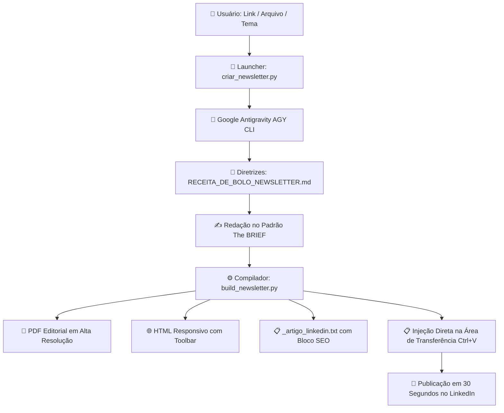

<div align="center">

# 📰 Decifrando Dados: Newsletter Autonomous Studio

**Agente 100% Autônomo para Produção, Diagramação e Publicação de Conteúdo Técnico no LinkedIn**

[](https://www.python.org/downloads/)
[](https://opensource.org/licenses/MIT)
[](https://github.com/google)
[](https://www.linkedin.com/newsletters/decifrando-dados-7513791689808064512/)

*Curadoria e Autoria: **Marlon Ferreira***  
*Formato Editorial Exclusivo: **The BRIEF** ("Smart people are cooler")*

</div>

---

## 💡 Sobre o Projeto

O **Decifrando Dados Studio** é um pipeline automatizado de ponta a ponta projetado para redigir, diagramar e compilar edições da newsletter oficial **[Decifrando Dados](https://www.linkedin.com/newsletters/decifrando-dados-7513791689808064512/)** no LinkedIn.

Diferente de geradores de texto genéricos, este sistema opera sob uma **Receita de Bolo Rígida** inspirada no padrão editorial **The BRIEF**: análises práticas e ágeis, dados reais mastigados, métricas financeiras de impacto, sarcasmo pop e **zero corporatiquês**.

---

## 🏗️ Arquitetura do Pipeline



---

## ✨ Recursos Principais

1. **Disparo com 1 Clique:**
   - Dê duplo clique em `Iniciar Gerador de Newsletter.bat`, cole seu link ou tema e o sistema faz 100% do trabalho de forma autônoma.
2. **Formato Editorial "The BRIEF":**
   - **Efeméride/Nostalgia:** "Há X anos na tecnologia..." conectando o passado à pauta.
   - **Índice Âncora:** "⚡ O que você vai ver hoje" (sumário escaneável em 5 segundos).
   - **Matéria de Capa:** Categoria em caixa alta, métrica real destacada (`💡 O número do jogo`) e provocação direta à liderança (`🎯 Recado para a diretoria`).
   - **Don't Leave, Just Read:** Giro expresso de 3 a 4 notícias com emojis.
   - **Decifrando na Prática:** 3 passos técnicos acionáveis para o leitor.
   - **Filtro Anticlichê:** Proíbe jargões vazios como *"mergulhar"*, *"revolucionário"*, *"crucial"* e travessões em excesso.
3. **Pacote Completo de Publicação no LinkedIn:**
   - **Metadados de SEO:** Título e Descrição (140 a 160 caracteres) otimizados para o Google e o buscador do LinkedIn.
   - **Post de Divulgação do Feed:** Gancho instigante, contextualização e hashtags estratégicas.
   - **Injeção no Clipboard:** O texto formatado já é copiado para a Área de Transferência do Windows (`Ctrl + V`).
4. **PDF de Alta Resolução:**
   - Diagramação com tipografia moderna, fontes Google Fonts (Plus Jakarta Sans) e compilação vetorial via Microsoft Edge headless.

---

## 📂 Estrutura do Repositório

```text
├── Iniciar Gerador de Newsletter.bat  # Atalho de 1 clique para execução no Windows
├── criar_newsletter.py               # Launcher interativo com o super prompt AGY
├── build_newsletter.py               # Compilador (Markdown -> HTML -> PDF -> LinkedIn)
├── template.html                     # Template diagramado para visualização e PDF
├── RECEITA_DE_BOLO_NEWSLETTER.md     # Manual de diretrizes editoriais milimétricas
├── .gitignore                        # Regras de exclusão do Git
├── LICENSE                           # Licença MIT
├── README.md                         # Documentação oficial
└── examples/
    └── exemplo_edicao_the_brief.md   # Edição completa de referência
```

---

## 🚀 Como Executar

### Pré-requisitos
* **Python 3.10+** instalado no sistema.
* **Google Antigravity CLI (`agy`)** configurado no PATH ou em `C:\Users\marlo\AppData\Local\agy\bin\agy.exe`.
* **Microsoft Edge** ou **Google Chrome** (para compilação headless do PDF).

### Opção 1: Pelo Executável (Windows)
1. Dê um duplo clique no arquivo `Iniciar Gerador de Newsletter.bat`.
2. Cole o **Link de notícia**, o caminho de um **Arquivo** ou apenas o **Tema** desejado.
3. Aperte `Enter` e acompanhe o AGY gerando tudo de forma autônoma.

### Opção 2: Pelo Terminal / Linha de Comando
```bash
python criar_newsletter.py
```

### Opção 3: Compilar um Markdown Manualmente
Se você já tiver um arquivo `.md` pronto e quiser apenas compilar o PDF e o pacote LinkedIn:
```bash
python build_newsletter.py --input examples/exemplo_edicao_the_brief.md --output-dir ./dist --pdf --copy
```

---

## 🍽️ Publicando no LinkedIn em 30 Segundos

1. Abra o arquivo `.html` gerado na pasta de saída.
2. Copie manualmente o **Título SEO** e a **Descrição SEO** da caixa cinza no topo.
3. Clique no botão azul: **"📋 Copiar Texto Formatado e Abrir LinkedIn"**.
4. No editor de artigos do LinkedIn, aperte **Ctrl + V**.
5. Cole os metadados de SEO nas configurações do artigo (ícone de engrenagem).
6. Avance e cole o **Post de Divulgação** na caixa *"Conte para sua rede..."*.
7. Clique em **Publicar**!

---

## 📄 Licença

Este projeto é distribuído sob a licença [MIT](LICENSE).

---

<div align="center">
Desenvolvido com carinho para <strong>Marlon Ferreira</strong> • <strong>Decifrando Dados</strong>
</div>
